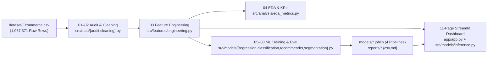
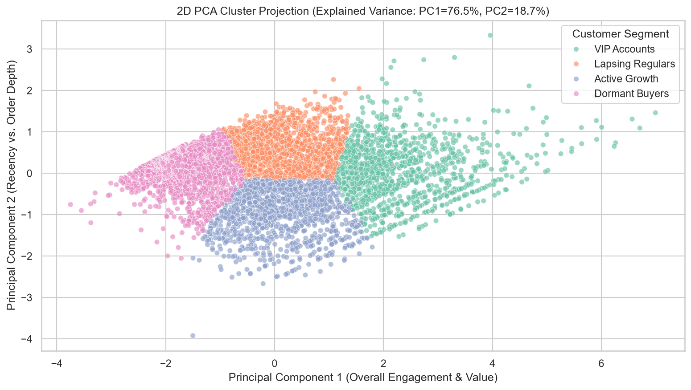
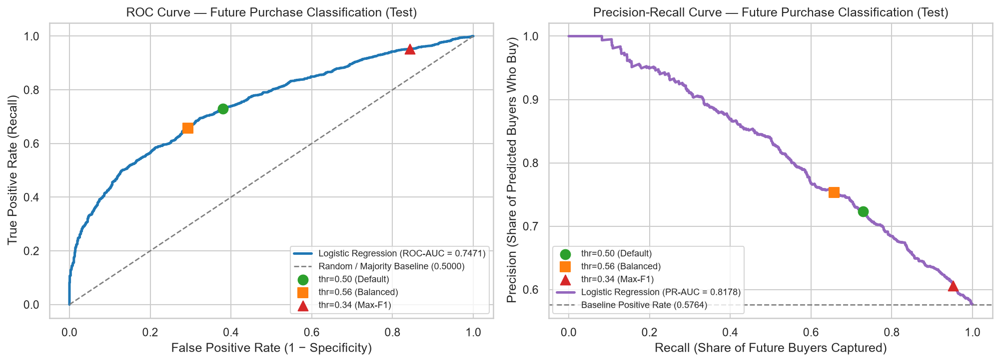

<div align="center">

# E-Commerce Customer Analytics

**End-to-End Business Intelligence, Customer RFM Segmentation, Recommendation & Predictive ML Suite**

[](https://www.python.org/)
[](app/app.py)
[](src/models/)
[](visualizations/)
[](dataset/Ecommerce.csv)
[](tests/)

*Built exclusively on verified real UCI Online Retail II transactions (`2009-12-01` to `2011-12-09`) — zero synthetic customers, ratings, or demographics.*

[Overview](#overview) • [Architecture](#architecture) • [Quick Start](#quick-start) • [Notebooks](#analytical-notebooks-0108) • [ML Results](#machine-learning-models--verified-benchmarks) • [Dashboard](#interactive-streamlit-dashboard-11-pages) • [Full Report](reports/final_project_report.md)

</div>

---

## Executive Snapshot

| Business & Data Metric | Verified Result | ML & Engineering Artifact | Verified Result |
|---|---:|---|---:|
| **Raw Audit Volume** | `1,067,371` rows × `8` cols | **Future Spend (Linear Regression)** | Test `R² = 0.5511` \| `MAE = £586.61` |
| **Validated Transactions** | `1,026,678` rows (`96.19%` retained) | **Repeat Purchase (Logistic Regression)** | `ROC-AUC = 0.7471` \| `PR-AUC = 0.8178` |
| **Net Realized Revenue** | **`£19,265,931.71`** (`39,988` orders) | **Recommendations (Item-Based KNN)** | `Hit Rate@10 = 38.48%` \| `Coverage = 24.72%` |
| **Purchasing Customers & SKUs** | `5,869` buyers \| `4,746` merchandise SKUs | **Segmentation (K-Means RFM)** | `K = 4` (`Silhouette = 0.3668`) + `ClusterID = -1` |
| **Geographic Reach** | `43` markets (`85.12%` UK core) | **Dashboard & Test Suite** | `11` Streamlit pages \| `19/19` tests passing |

---

## Overview

Raw e-commerce transaction logs contain duplicate multi-sheet exports, customer returns (`C`-invoices), internal warehouse stock adjustments, accounting bad-debt entries (`A`-invoices), postage fees, and unregistered guest checkouts. Treating those records naively distorts executive KPIs and introduces temporal data leakage into predictive modeling.

This project implements a disciplined, modular analytics and ML system covering:
1. **Immutable Audit & Rule-Based Cleaning:** Read-only SHA-256 verification of `dataset/Ecommerce.csv`, deduplication (`34,335` exact duplicates including `22,844` Dec 2010 sheet-overlap rows), separation of `18,855` valid customer cancellations (`-£1,168,287.81`), and honest preservation of `228,994` guest checkouts.
2. **Leakage-Free Predictive Modeling:** Chronological `275d → 90d` Q4 splits for spending forecasting and purchase propensity, chronological holdout evaluation for sparse Item-Based Cosine KNN, and `log1p`-scaled RFM segmentation.
3. **Productionized Code & BI Application:** Clean, tested Python packages under `src/`, serialized pipelines in `models/`, and an interactive 11-page web dashboard under `app/`.

---

## Architecture



---

## Problem Statement & Objectives

| Business Question | Engineering & Modeling Solution |
|---|---|
| What is the true net revenue once overlaps, write-offs, and returns are accounted for? | Rule-based cleaning separating normal sales (`£20.43M`) and valid `C`-returns (`-£1.17M`) |
| How much will an eligible customer spend in the upcoming 90-day Q4 window? | Non-leaking chronological `LinearRegression` pipeline benchmarked vs. Mean/Median/Simple OLS |
| Which active buyers are most likely to make a repeat purchase in the next 90 days? | Signed-`log1p` `LogisticRegression` with train-CV threshold tuning (`0.34` max-F1 / `0.56` balanced precision) |
| What complementary merchandise SKUs should be recommended per buyer or product? | Sparse CSR **Item-Based Cosine KNN** (`min_item_customers=5`) + cold-start bestseller fallback |
| Which behavioral RFM segments drive revenue vs. churn risk? | `log1p`-scaled `KMeans` (`K = 4` + isolated `ClusterID = -1` for `MonetaryValue <= £0` accounts) |

---

## Visual Highlights

| Customer RFM Clusters (`2D PCA: 95.19% Variance`) | Repeat Purchase Classifier (`ROC & PR Curves`) |
|---|---|
|  |  |

---

## Quick Start

### 1. Clone & Set Up Virtual Environment (Windows PowerShell)

```powershell
git clone https://github.com/Pratim-karmakar/Ecommerce_Consumer_Behavior_Analysis.git
cd Ecommerce_Consumer_Behavior_Analysis

python -m venv .venv
.\.venv\Scripts\python.exe -m pip install --upgrade pip
.\.venv\Scripts\python.exe -m pip install -r requirements.txt
.\.venv\Scripts\python.exe -m pip check
```

### 2. Regenerate `>100 MB` Transaction CSVs (After Fresh Clone)

> **GitHub Storage Note:** Three derived transaction CSVs exceeding GitHub's `100 MB` limit (`dataset/processed/cleaned_online_retail.csv` at `118.3 MB`, `sales_transactions.csv` at `115.8 MB`, and `transaction_features.csv` at `168.7 MB`) are excluded via `.gitignore`. Customer, product, country, monthly analytics tables (`dataset/processed/analytics/`), trained `.joblib` models (`models/`), and raw `dataset/Ecommerce.csv` are all tracked in Git.

Before running the transaction-level dashboard pages on a fresh clone, execute Notebooks `02` and `03` once to regenerate those three local CSVs:

```powershell
.\.venv\Scripts\python.exe -m ipykernel install --user --name ecommerce-analytics --display-name "Python (.venv - E-Commerce Analytics)"
.\.venv\Scripts\python.exe -m nbconvert --to notebook --execute --inplace --ExecutePreprocessor.kernel_name=ecommerce-analytics notebooks/02_Data_Cleaning.ipynb
.\.venv\Scripts\python.exe -m nbconvert --to notebook --execute --inplace --ExecutePreprocessor.kernel_name=ecommerce-analytics notebooks/03_Feature_Engineering.ipynb
```

### 3. Run Tests & Launch the Dashboard

```powershell
# Run all 19 unit, inference, and headless Streamlit dashboard tests
.\.venv\Scripts\python.exe -m unittest discover -s tests -t . -v

# Start the 11-page Streamlit app (http://localhost:8501)
.\.venv\Scripts\python.exe -m streamlit run app/app.py
```

*(Using `.\.venv\Scripts\python.exe -m ...` prevents Windows Application Control or PowerShell script policies from blocking `.venv\Scripts\*.exe` wrappers.)*

---

## Analytical Notebooks (`01–08`)

<details>
<summary><b>Click to view the complete 8-notebook pipeline sequence</b></summary>

| # | Notebook | Purpose | Key Output Artifacts |
|---|---|---|---|
| `01` | [`01_Data_Inspection.ipynb`](notebooks/01_Data_Inspection.ipynb) | Non-destructive quality audit (missingness, duplicates, cancellations, anomalies) | `reports/data_quality_report.{csv,md}` |
| `02` | [`02_Data_Cleaning.ipynb`](notebooks/02_Data_Cleaning.ipynb) | Standardized types, removed `40,693` noise rows, split sales vs. returns | `dataset/processed/*.csv`, `reports/data_cleaning_report.md` |
| `03` | [`03_Feature_Engineering.ipynb`](notebooks/03_Feature_Engineering.ipynb) | Temporal transaction features + Customer RFM (`ref = 2011-12-10`), Product, Country, Monthly tables | `dataset/processed/analytics/*.csv` |
| `04` | [`04_Exploratory_Data_Analysis.ipynb`](notebooks/04_Exploratory_Data_Analysis.ipynb) | Seasonality, weekday/hour cadence, Pareto 80/20, buyer concentration, export hubs | `reports/eda_business_insights.md`, `visualizations/` |
| `05` | [`05_Linear_Regression.ipynb`](notebooks/05_Linear_Regression.ipynb) | Chronological `275d → 90d` Q4 net spend regression vs. baselines | `models/linear_regression_pipeline.joblib`, `reports/linear_regression_results.csv` |
| `06` | [`06_Logistic_Regression.ipynb`](notebooks/06_Logistic_Regression.ipynb) | Signed-`log1p` binary purchase propensity + 5-fold CV threshold tuning | `models/logistic_regression_pipeline.joblib`, `reports/logistic_regression_results.csv` |
| `07` | [`07_KNN_Recommendation.ipynb`](notebooks/07_KNN_Recommendation.ipynb) | Item-KNN vs. User-KNN vs. Popularity evaluation + cold-start fallback | `models/knn_recommender.joblib`, `reports/knn_recommender_results.csv` |
| `08` | [`08_KMeans_Customer_Segmentation.ipynb`](notebooks/08_KMeans_Customer_Segmentation.ipynb) | Elbow & Silhouette (`K=2..9`) selection (`K=4`), PCA projection, segment profiles | `models/kmeans_pipeline.joblib`, `customer_segments.csv`, `reports/kmeans_cluster_summary.csv` |

</details>

---

## Machine Learning Models & Verified Benchmarks

All predictors expose unified, schema-validated functions in [`src/models/inference.py`](src/models/inference.py) handling invalid types, missing models (`ModelLoadError`), missing numeric inputs (`SimpleImputer`), unknown SKUs (`UnknownProductError`), unseen users (popularity fallback), and negative monetary values (`ClusterID = -1`).

### 1. Future Customer Spending — Linear Regression ([`linear_regression_results.csv`](reports/linear_regression_results.csv))
- **Pipeline:** `SimpleImputer(median)` → `StandardScaler()` → `LinearRegression()`
- **Chronological Split:** Train (`2009–2010`, `n = 3,270`) → Test (`2010-12-10` to `2011-09-10` predicting Q4 `2011-09-11` to `2011-12-09`, `n = 3,248`)

| Model / Baseline (Test `n = 3,248`) | MAE (£) | RMSE (£) | R² |
|---|---:|---:|---:|
| Mean Baseline | 935.35 | 4,069.36 | -0.0002 |
| Median Baseline | 775.43 | 4,109.58 | -0.0201 |
| Simple OLS (`hist_spending` only) | 596.71 | 2,732.93 | 0.5489 |
| **Linear Regression (Full Pipeline)** | **586.61** | **2,726.22** | **0.5511** |

### 2. Future Repeat Purchase — Logistic Regression ([`logistic_regression_results.csv`](reports/logistic_regression_results.csv))
- **Pipeline:** `SimpleImputer(median)` → `signed_log1p` → `StandardScaler()` → `LogisticRegression(max_iter=1000)`

| Operating Point (Test `n = 3,248`) | Threshold | Accuracy | Precision | Recall | F1 | ROC-AUC | PR-AUC |
|---|---:|---:|---:|---:|---:|---:|---:|
| Majority Class Baseline | 0.50 | 0.5764 | 0.5764 | 1.0000 | 0.7312 | 0.5000 | 0.5764 |
| **Signed-Log1p LogReg (Default)** | **0.50** | **0.6832** | **0.7234** | **0.7292** | **0.7263** | **0.7471** | **0.8178** |
| Balanced Precision (`CV-tuned`) | 0.56 | 0.6786 | 0.7534 | 0.6576 | 0.7022 | 0.7471 | 0.8178 |
| High-Recall / Max-F1 (`CV-tuned`) | 0.34 | 0.6155 | 0.6059 | 0.9519 | 0.7405 | 0.7471 | 0.8178 |

### 3. Product Recommendation — Item-Based Cosine KNN ([`knn_recommender_results.csv`](reports/knn_recommender_results.csv))
- **Configuration:** Cosine similarity over `log1p(quantity)` CSR matrix (`5,851` customers × `4,200` merchandise SKUs with `>= 5` training buyers, `n_neighbors = 25`)

| Holdout Method (`K = 10`, Exclude Seen, `n = 2,196`) | Precision@10 | Recall@10 | Hit Rate@10 | Catalog Coverage |
|---|---:|---:|---:|---:|
| Popularity Baseline | 0.0412 | 0.0168 | 29.10% | 1.80% (`80` SKUs) |
| User-Based KNN (Cosine) | 0.0593 | 0.0304 | 35.97% | 23.28% (`1,035` SKUs) |
| **Item-Based KNN (Cosine)** | **0.0668** | **0.0355** | **38.48%** | **24.72% (`1,099` SKUs)** |

### 4. Customer Segmentation — K-Means RFM Clustering ([`kmeans_cluster_summary.csv`](reports/kmeans_cluster_summary.csv))
- **Configuration:** `FunctionTransformer(np.log1p)` → `StandardScaler()` → `KMeans(n_clusters=4)` (`Silhouette = 0.3668` beating `K=3` at `0.3472` and `K=5` at `0.3459`; `40` non-positive spenders isolated cleanly into `ClusterID = -1`)

| Cluster | Segment | Customers | Share | Median R (d) | Median F | Median M (£) | Revenue Share |
|---:|---|---:|---:|---:|---:|---:|---:|
| `0` | **High-Value Loyal** | 1,193 | 20.33% | 17.0 | 13.0 | £4,888.75 | **74.16%** |
| `1` | **At-Risk Established** | 1,446 | 24.64% | 185.0 | 5.0 | £1,422.08 | **16.01%** |
| `2` | **Recent / Growing** | 1,256 | 21.40% | 24.5 | 3.0 | £709.28 | 6.34% |
| `3` | **Dormant / Low-Engagement** | 1,934 | 32.95% | 403.0 | 1.0 | £265.41 | 3.69% |
| `-1` | **Net-Returned / Zero-Spend** | 40 | 0.68% | 426.5 | 1.0 | £0.00 | -0.19% |

---

## Interactive Streamlit Dashboard (`11` Pages)

Organized into four sidebar groups inside [`app/app.py`](app/app.py) with light BI styling ([`.streamlit/config.toml`](.streamlit/config.toml), [`app/utils/theme.py`](app/utils/theme.py)) and CSV exports on every analytical view:

| Navigation Group | Pages | Core Features |
|---|---|---|
| **Overview** | 1. Home (`p01_home.py`) | Executive KPI cards, Monthly Gross vs. Net Revenue chart, pipeline summary & navigation guide |
| **Business Analytics** | 2. Sales (`p02_sales.py`)<br>3. Customers (`p03_customers.py`)<br>4. Products (`p04_products.py`)<br>5. Countries (`p05_countries.py`) | Year/country/scope filters, weekday & hourly cadence, top accounts & spend/frequency histograms, SKU search & bubble charts, UK vs. international treemap, CSV downloads |
| **Predictive & Recommender ML** | 6. Future Spending (`p06_future_spending.py`)<br>7. Purchase Prediction (`p07_purchase_pred.py`)<br>8. Product Recommendation (`p08_recommendations.py`)<br>9. Customer Segmentation (`p09_segmentation.py`) | Cohort vs. live What-If spend simulator, threshold tuning (`0.10–0.90`) + live confusion metrics, Item-KNN + cold-start fallback & co-purchase lookup, PCA cluster viewer + live RFM scorer |
| **Evaluation & Governance** | 10. Model Performance (`p10_model_perf.py`)<br>11. Data Quality (`p11_data_quality.py`) | Side-by-side baseline comparison tabs + diagnostic plots (`05`–`08`), unified evaluation report, missingness/anomaly charts, full cleaning audit |

---

## Project Folder Structure

<details>
<summary><b>Click to inspect the complete repository layout</b></summary>

```text
Ecommerce_Consumer_Behavior_Analysis/
├── .streamlit/config.toml              # Light executive BI theme & browser config
├── app/
│   ├── app.py                          # Multi-page Streamlit entrypoint (st.navigation)
│   ├── components/ui.py                # Reusable KPI cards, banners, pills, CSV exports
│   ├── pages/p01_home.py .. p11_data_quality.py
│   └── utils/{data_loader,theme}.py    # Cached loaders (@st.cache_data/resource) & CSS/Plotly styling
├── dataset/
│   ├── Ecommerce.csv                   # Raw immutable source CSV (SHA-256 verified)
│   └── processed/
│       ├── returns_and_cancellations.csv
│       └── analytics/{country,customer,customer_segments,monthly_sales,product_analytics}.csv
├── models/                             # Serialized .joblib pipelines (LR, LogReg, KNN, K-Means)
├── notebooks/                          # Executed Jupyter notebooks (01–08)
├── reports/
│   ├── final_project_report.md         # Structured 15-section academic report
│   ├── model_evaluation_summary.md     # Unified ML verification summary
│   └── *.{csv,md}                      # Audit, cleaning, EDA & benchmark metric files
├── src/
│   ├── analysis/eda_metrics.py
│   ├── data/{audit,cleaning}.py
│   ├── features/engineering.py
│   ├── models/{classification,inference,recommender,regression,segmentation}.py
│   └── utils/paths.py
├── tests/                              # 9 unittest + headless Streamlit AppTest modules
├── visualizations/                     # 25 exported PNG & interactive HTML figures
├── .gitignore
├── README.md
└── requirements.txt
```

</details>

---

## Limitations & Future Improvements

- **Missing Customer IDs (`22.3%` post-cleaning transactions):** Guest orders (including `100%` of Bermuda & Hong Kong) are preserved for revenue/product totals but cannot be scored by customer-level ML or collaborative filtering.
- **Wholesale Target Outliers in OLS:** `54` extreme Q4 wholesale accounts (`> £5,000`) drive over `93%` of MSE (`RMSE = £2,726.22` vs. `£718.28` trimmed to the 99th percentile). Future work should explore a two-stage Hurdle model (`P(buy) × E[spend | buy]`) and gradient boosting (`HistGradientBoostingRegressor` / `LightGBM`).
- **Partial Boundary Years & Recommender Cold-Start SKUs:** `2009` includes December only and `2011` stops at Dec 9; pure Item-KNN requires `>= 5` historical buyers per SKU, which a hybrid TF-IDF + co-purchase ranker could address alongside probabilistic GMM segmentation and month-over-month cluster migration tracking.

---

## Documentation & Reports

- **Complete Academic Report:** [`reports/final_project_report.md`](reports/final_project_report.md)
- **Unified ML Verification Report:** [`reports/model_evaluation_summary.md`](reports/model_evaluation_summary.md)
- **Data Audit & Cleaning Logs:** [`reports/data_quality_report.md`](reports/data_quality_report.md) • [`reports/data_cleaning_report.md`](reports/data_cleaning_report.md) • [`reports/eda_business_insights.md`](reports/eda_business_insights.md)
